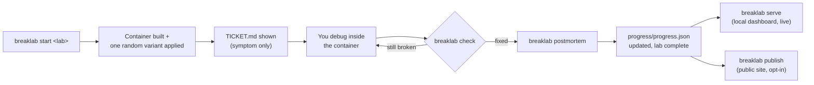
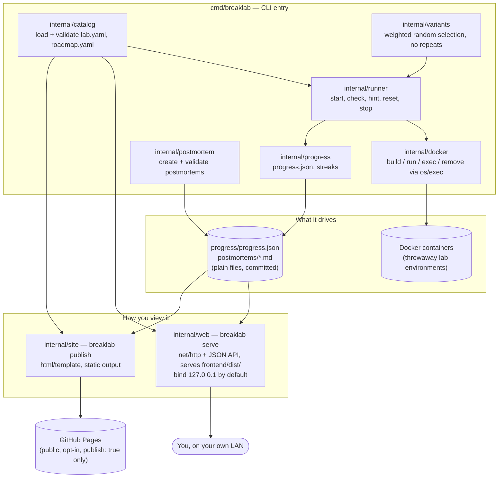
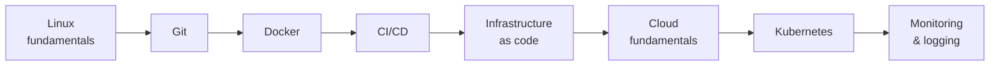

# BreakLab

**A personal, offline-first DevOps training ground: break a throwaway Docker
environment at random, get only a symptom, fix it yourself, and keep a
record you own.**

BreakLab is modeled on hands-on break/fix platforms like
[devopslabs.dev](https://devopslabs.dev) — real machines, a symptom-only
incident brief, no instructions, one roadmap from your first shell to
Kubernetes — but built for one person, running locally:

- **Everything runs on your own machine.** No cloud-only labs you can't
  touch offline. Docker is the only dependency.
- **Your progress is plain files you own.** `progress/progress.json` and
  `postmortems/*.md` live in your own git repo, not rows in someone else's
  database.
- **One statically-linked binary.** No language runtime or dependency
  install beyond Docker — fast enough to run well on a Raspberry Pi 5.

> Built with [OpenSpec](https://openspec.dev) as a spec-driven project —
> see [`docs/breaklab-spec.md`](docs/breaklab-spec.md) for the full build
> spec and [`openspec/specs/`](openspec/specs/) for the requirements each
> feature was built against.

## How it works

1. `breaklab start <lab>` builds a fresh container and secretly applies one
   random breakage.
2. You read the ticket — the symptom only, never the cause — and debug
   inside the container.
3. `breaklab check` tells you whether the symptom is gone.
4. `breaklab postmortem` opens a pre-filled postmortem you must complete
   before the lab counts as done.
5. `breaklab serve` runs a local web UI — dashboard, roadmap, challenge
   browser — reading your live progress, no publish step required.
6. `breaklab publish` rebuilds your public progress site from completed
   labs and published postmortems.



## Features

- **Random, non-repeating variants** — each lab has two or more ways to
  break, weighted selection, never the same variant twice in a row.
- **Outcome-based checks** — a check verifies the symptom is gone (e.g.
  the site serves the right page), not a specific fix, so any valid repair
  passes.
- **Tiered hints** — general hints first, then the active variant's hints,
  one at a time, counted.
- **Postmortems that count** — a lab is only "complete" once its postmortem
  has real content (Summary, Detection, Root cause, Fix, Prevention; 20+
  words each) — writing the fix up is what makes it stick.
- **Local web UI** — dashboard, roadmap, a challenge browser (filterable by
  stage, difficulty, status, and topic tag), and a lab detail/postmortem
  viewer, all reading your files live via `breaklab serve`.
- **Public progress site** — a static site built with `breaklab publish`
  and deployed to GitHub Pages by your own CI, so the deploy pipeline is
  itself DevOps practice. Unpublished postmortems and all variant/solution
  scripts never leave your machine.
- **Security-reviewed by design** — `os/exec` with argument slices only
  (no shell interpolation), strict id/path validation
  (`^[a-z0-9-]+$`), `govulncheck` in CI, SHA-pinned GitHub Actions. See
  [`openspec/specs/security/spec.md`](openspec/specs/security/spec.md).

## Quick start

**Prerequisites:** [Go](https://go.dev) 1.26+, [Node.js](https://nodejs.org) 24+
(build-time only — `breaklab serve` needs no Node runtime), [Docker](https://docs.docker.com/get-docker/), Git.

```bash
git clone <this-repo> breaklab
cd breaklab

cd frontend && npm ci && npm run build && cd ..   # builds frontend/dist/
go build -o breaklab ./cmd/breaklab

./breaklab list                 # see the catalog
./breaklab start web-down       # break it
docker exec -it breaklab-web-down bash   # go fix it
./breaklab check                # did it work?
./breaklab postmortem           # write up what happened
./breaklab serve                # local dashboard at http://127.0.0.1:8787
```

The frontend (`frontend/`) is an [Astro](https://astro.build) +
[Astryx](https://astryx.atmeta.com) project that builds to static
HTML/JS/CSS; Go serves that build output from disk (`--frontend`,
defaulting to `frontend/dist`) — there is no Node process at request
time, only at build time, the same "ships as one statically-linked
binary" constraint as the rest of the CLI. Rebuild `frontend/dist`
(`npm run build`) whenever you change anything under `frontend/src/`;
`breaklab serve` always reads it from disk, live.

For frontend development, run Astro's dev server and the Go backend
side by side — `npm run dev` (in `frontend/`) proxies `/api/*`,
`/sync/*`, `/signup`, `/login`, etc. to `breaklab serve` on `:8787`, so
a browser pointed at the Astro dev origin (printed by `npm run dev`,
typically `:4321`) gets live-reloading frontend changes against a real
backend.

## CLI reference

| Command | What it does |
|---|---|
| `breaklab list` | List labs grouped by roadmap stage |
| `breaklab start <lab>` | Build a container and apply one random breakage |
| `breaklab check` | Check whether the active lab is fixed |
| `breaklab hint` | Reveal the next hint for the active lab |
| `breaklab reset` | Recreate the active lab with the same breakage |
| `breaklab stop` | Remove the active lab's container |
| `breaklab status` | Show per-stage progress, the active lab, and your streak |
| `breaklab postmortem` | Write up or validate a postmortem for a solved lab |
| `breaklab publish` | Rebuild `site/` from progress, labs, and published postmortems |
| `breaklab serve [--host] [--port] [--frontend] [--db]` | Serve the local dashboard, roadmap, and challenge browser |

Every command has `--help`. `breaklab serve` binds to `127.0.0.1` by
default; pass `--host 0.0.0.0` (or a LAN address) only when you explicitly
want it reachable from another device — the UI has no authentication by
design (single-user tool), and the CLI prints a one-time warning when you
opt into that.

## Architecture



Repo layout:

```text
breaklab/
  cmd/breaklab/           CLI entry, subcommand wiring
  internal/
    catalog/              load and validate lab.yaml, roadmap.yaml
    docker/                build, run, exec, remove via the docker CLI
    variants/              weighted random selection, no repeats
    runner/                start, check, hint, reset, stop
    progress/              progress.json and streaks
    postmortem/            create and validate postmortems
    site/                  builds site/ with html/template (public, publish-triggered)
    web/                   breaklab serve: local HTTP server, JSON API, reads live files
    audit/                 security-audit checks (CI workflows, dependencies, gitignore)
  labs/<lab-id>/           one folder per lab: lab.yaml, TICKET.md, Dockerfile,
                           check.sh, variants/, solutions/ — data, not code
  frontend/                Astro + Astryx local app and hosted-account pages;
                           builds to frontend/dist/, served by internal/web
  templates/
    web/                   vendored static assets only (fonts, cytoscape.min.js) —
                           every page template moved to frontend/
    site/                  public site templates (breaklab publish, unaffected by frontend/)
    postmortem.md          postmortem template copied by `breaklab postmortem`
  roadmap.yaml             stage order, drives both the CLI and the web UI
  progress/progress.json   your attempt history (committed)
  postmortems/             your postmortems (committed)
  openspec/                config.yaml, specs/ (source of truth), changes/ (in-flight work)
  docs/                    breaklab-spec.md, deploy-raspberry-pi.md
  .github/workflows/       ci.yml, publish.yml
```

## Lab format

A lab is a folder of data and Bash scripts — adding a lab never requires
touching the CLI's Go code:

```text
labs/web-down/
  lab.yaml             # metadata, variants, hints, tags
  TICKET.md            # the symptom only, never the cause
  Dockerfile            # the healthy environment
  check.sh              # exit 0 = fixed
  variants/             # each applies one breakage inside the container
    config-typo.sh
    port-taken.sh
    bad-perms.sh
  solutions/             # reference fixes, used only by automated tests
    config-typo.sh
    port-taken.sh
    bad-perms.sh
```

Script contracts:

- **Variant scripts** run inside the container as root after it starts;
  they leave the environment broken and exit 0.
- **Check scripts** print one line explaining the result and receive
  `BREAKLAB_CONTAINER` and `BREAKLAB_PORT_<container-port>` as environment
  variables.
- **Solution scripts** apply the reference fix for one variant — the CLI
  never runs them for the user, only the integration tests do.

The roadmap (`roadmap.yaml`) is one file at the repo root; its stage order
sets the order of the CLI listing, the web UI, and the public site:



## Testing

```bash
gofmt -l .          # formatting
go vet ./...         # static checks
go test ./...         # unit + integration tests (Docker required for lab integration tests)

cd frontend
npm run audit        # npm audit --omit=dev --audit-level=high
npm run build        # also catches Astro/TypeScript errors
```

Go's test fixtures never read the real `frontend/dist` — each test that
needs a `FrontendDir` builds its own minimal stub, so `go test ./...`
passes without running the frontend build first.

CI (`.github/workflows/ci.yml`) runs the frontend install/audit/build
step, then `gofmt`, `go vet`, `go test ./...`, and the lab integration
tests on `ubuntu-latest` on every pull request, plus a `linux/arm64`
cross-compile as a build smoke check for the Raspberry Pi 5 target.
`govulncheck` runs as a dependency audit gate for the Go module
(`npm run audit` above is the equivalent gate for `frontend/`).

## Deployment

- **Locally:** build `frontend/dist` once, then run `breaklab serve` —
  see [Quick start](#quick-start).
- **Headless, on your home LAN (e.g. a Raspberry Pi 5):** full step-by-step
  instructions, including running it as a systemd service, are in
  [`docs/deploy-raspberry-pi.md`](docs/deploy-raspberry-pi.md).
- **Public progress page:** `breaklab publish` builds `site/`;
  `.github/workflows/publish.yml` deploys it to GitHub Pages on every push
  to `main`. Nothing with `publish: false` in its postmortem front matter,
  and no variant or solution script, ever reaches `site/`.
- **Hosted accounts (opt-in, separate deployment shape):** `breaklab serve
  --db <path>` additionally mounts signup/login, `breaklab sync`'s API,
  and an opt-in public profile page (`/u/<name>`). This is a different
  trust model from the two deployments above — those are unauthenticated
  by design, local or LAN-only. A `--db` deployment handles real
  credentials and should sit behind TLS and real network exposure
  planning, the same as any other service holding passwords and session
  tokens. Lab execution never moves server-side either way: `breaklab
  sync` only ever exchanges `progress.json` records, never runs Docker.

## Project status

Built as a sequence of small [OpenSpec](https://openspec.dev) changes —
see [`docs/breaklab-spec.md`](docs/breaklab-spec.md) for the full build
spec and change plan, and [`openspec/specs/`](openspec/specs/) for the
current, merged requirements each area of the app is built against.
In-flight proposals live under `openspec/changes/`; completed ones are
archived under `openspec/changes/archive/`.

## References

- [devopslabs.dev](https://devopslabs.dev) — the hands-on platform this
  project takes its format from (incident-brief challenges, roadmap,
  certification-style structure), reimplemented standalone for personal,
  offline use.
- [OpenSpec](https://openspec.dev/docs/opsx) — the spec-driven workflow
  used to plan and implement every change in this repo.
- [Astro](https://astro.build) + [Astryx](https://astryx.atmeta.com) —
  the local web UI and hosted-account pages' meta-framework and
  React 19/StyleX component library, in `frontend/`.
- [GitHub Pages](https://docs.github.com/en/pages) — hosts the public
  progress site built by `breaklab publish`.

## License

[MIT](LICENSE)
